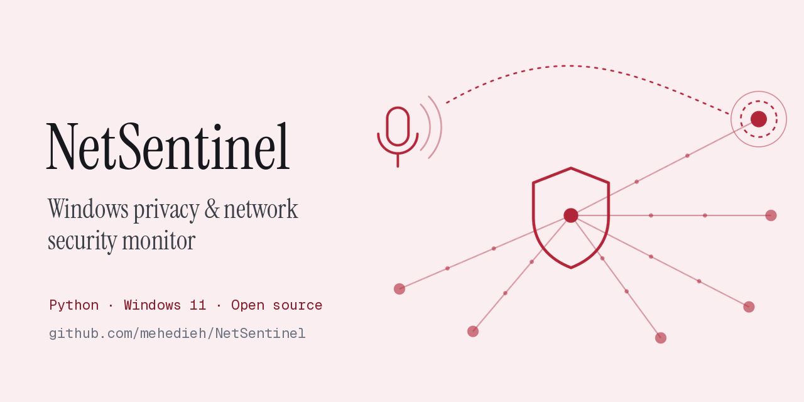
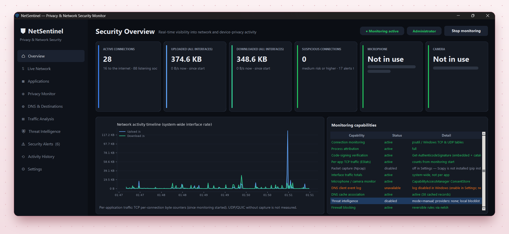

# NetSentinel — Windows Privacy & Network Security Monitor



[Project page](https://mehedieh.github.io/projects/netsentinel/) · MIT licence

A defensive desktop app for Windows 11. It shows what your PC is talking to, which program is responsible,
whether the microphone or camera was in use at the same time, and why anything was flagged.
Every finding comes with its evidence and its limits.

NetSentinel never hides itself, never opens the microphone or camera, never records content, never decrypts
TLS, never disables Defender or the Firewall, and never sends data anywhere unless you explicitly allow it.



---

## 1. Quick start (PowerShell)

```powershell
cd NetSentinel
powershell -ExecutionPolicy Bypass -File .\setup.ps1      # creates .venv, installs packages (no admin)
.\run.ps1                                                  # standard user (least privilege)
.\run.ps1 -Admin                                           # elevated: unlocks admin-only features
```

No PowerShell? Just double-click **`setup.bat`**, then **`run.bat`** (or **`run-as-admin.bat`**).
If PowerShell says a script "is not digitally signed", the files still carry the download mark: run
`Get-ChildItem -Recurse | Unblock-File` in the folder, or use the `.bat` launchers.

Manual alternative:

```powershell
py -3.13 -m venv .venv
.\.venv\Scripts\python.exe -m pip install -r requirements.txt
.\.venv\Scripts\python.exe main.py
```

**Automatic package installation.** When run from source, `main.py` checks every required package on start.
Missing or outdated packages are installed or upgraded with pip into the same interpreter or venv, using
`--user` when system Python isn't writable. To turn this off, use `--no-auto-install`. To also pull in the
optional packages, use `--with-optional`. The packaged `.exe` bundles everything and never runs pip.

Other commands:

| Command | Purpose |
|---|---|
| `python main.py --check` | Windows version, privileges, package versions and capability report |
| `python main.py --headless -d 60 --report full --format json` | Monitor for 60 s without a GUI and export a report |
| `python -m pytest -q` | Run the test suite |

### Requirements
* Windows 11 (Windows 10 1903+ works). Python **3.12 or 3.13**, 64-bit.
* `requirements.txt`: psutil, customtkinter, matplotlib, requests. These are the only third-party imports.
  Windows APIs are reached through `ctypes`/`winreg` and the built-in `powershell`, `wevtutil` and `netsh`,
  so **pywin32, dnspython and httpx are not needed**.
* `requirements-optional.txt`: `scapy` (packet capture; also install [Npcap](https://npcap.com)) and
  `maxminddb` (offline GeoIP from a GeoLite2 `.mmdb` file you supply).

## 2. Build a portable .exe

```powershell
powershell -ExecutionPolicy Bypass -File .\build\build.ps1
# -> dist\NetSentinel.exe  (single file, no Python needed, runs without admin; uac_admin=False)
```

The build script runs the tests first and stops if any fail.

## 3. What is real, what is partial, and why

| Feature | Source | Admin? | Status |
|---|---|---|---|
| TCP/UDP connections, PIDs, states | `psutil` → `GetExtendedTcpTable` / `GetExtendedUdpTable` | No | Full (poll-based; sub-second sockets can be missed) |
| Exe path, owner, parent | psutil / process tokens | Partly | Protected processes hide their path without admin |
| Code signature + publisher | `Get-AuthenticodeSignature` (embedded **and catalog**), falling back to `WinVerifyTrust` | No | Full |
| Per-connection TCP bytes | `SetPerTcpConnectionEStats` / `GetPerTcpConnectionEStats` | **Yes** | Counts only from when monitoring began |
| UDP/QUIC bytes per app | Scapy + Npcap header lengths | **Yes** | Optional; headers only |
| Total traffic | Interface counters | No | Full, but **system-wide, not per app** |
| Mic / camera access | `CapabilityAccessManager\ConsentStore` (the same store behind the Windows privacy indicator) | No (other users: yes) | Current + last start/stop per app, desktop and Store apps |
| DNS queries | DNS-Client operational log (event 3008) | Enabling the log: **yes** | Off by default in Windows; enable it from the DNS page |
| Domain ↔ IP | DNS client cache (`Get-DnsClientCache`) | No | Full for cached names |
| Reverse DNS | `socket.gethostbyaddr` | No | Optional |
| Threat intel | VirusTotal / AbuseIPDB / OTX, local blocklist | No | Opt-in; sends only the IP or domain |
| Ownership / Geo | RDAP (opt-in), MaxMind `.mmdb` (offline) | No | Approximate |
| Blocking | `netsh advfirewall` reversible rules | **Yes** | Confirm → create → remove from Settings |

**Honesty rules built into the code**
* Byte counts are shown only when actually measured. Otherwise the UI says *"not measured"* and gives the reason.
* A public IP address is never suspicious on its own. Unsigned software is only a small factor.
* Heuristic-only scores are capped at **High**. **Critical** needs a verified threat-intel or blocklist match.
* A mic/camera correlation alert always says that timing is **not proof** that audio or video was sent.
* Telemetry Windows doesn't expose is labelled *Unavailable*. It is never simulated.

**Privacy monitor blind spots** (also listed in the app): drivers or software that use the hardware directly;
which *website* in a browser used the device; earlier sessions while NetSentinel wasn't running (Windows keeps
only the last start/stop per app); other user accounts without admin.

**DNS blind spots:** browser DNS-over-HTTPS bypasses the Windows DNS client and port 53. PIDs in DNS events
can belong to the DNS Client service.

## 4. Architecture

```
main.py                 CLI / launcher, dependency auto-install
core/monitor_service.py orchestrator: background loops, event bus, GUI snapshots
core/network_monitor.py connection diffing (new / established / repeated / closed), interface counters
core/process_monitor.py identity, parent, owner, batched signature worker
core/privacy_monitor.py ConsentStore reader + start/stop/short-session detection
core/correlation_engine.py device access ↔ outbound connection windows
core/traffic_analyzer.py byte accounting, spikes (EWMA), beaconing (interval CV), long-lived
core/packet_analyzer.py optional Scapy capture (headers + DNS names only)
core/dns_monitor.py     event log / cache / pcap DNS, tunnelling & DGA heuristics
core/risk_engine.py     explainable factors → score → level; alert builder; de-duplication
core/threat_intelligence.py providers, DPAPI key store, blocklist, RDAP, GeoIP
core/firewall.py        reversible block rules with safety checks
core/reports.py         CSV/JSON reports
database/               SQLite (WAL, single writer thread, migrations, retention)
gui/                    CustomTkinter app, 10 pages, dialogs, charts
utils/                  Windows API wrappers (ctypes), permissions, deps, paths, logging
```

Threads: network, privacy, dns-log, dns-cache, maintenance, signature worker, rDNS pool, DB writer,
and optional capture. The GUI reads snapshots and drains a bounded event queue on a Tk timer, so it never
blocks. Monitoring keeps running whichever page is open. A failing loop backs off and recovers, and the
error is shown in the UI.

Data lives in `%LOCALAPPDATA%\NetSentinel\`: the database, `logs\`, `reports\`, `settings.json`, the
DPAPI-encrypted `secrets.bin` and `blocklist.txt`. No payloads, audio, video, passwords, cookies or command
lines are stored.

## 5. Testing

`python -m pytest -q` runs 47 tests:
* **Unit:** IP classification, risk scoring and caps, alert sections and de-duplication, privacy
  start/stop/short-session detection (simulated registry), packaged-app matching, correlation windows and
  wording, traffic deltas and spikes, beaconing, DNS heuristics and event-XML parsing, ipconfig parsing,
  signature parsing, blocklist, threat-intel consent rules, config validation, auto-install.
* **Integration:** real local TCP connections (detection, inbound/outbound, process attribution, close,
  repeats), database migrations, reports, and a full service run with a simulated mic event that produces a
  correlation alert.
* **GUI smoke:** opens every page and dialog. Uses real CustomTkinter on Windows.

### Manual verification on Windows (safe, no malware)
1. **TCP and process attribution:** run `Test-NetConnection example.com -Port 443`. Live Network shows
   `powershell.exe` → port 443, signed by Microsoft.
2. **Inbound:** `py -m http.server 8000`, then open `http://localhost:8000`. You'll see an inbound loopback
   connection and a listening socket.
3. **DNS:** enable the DNS log as admin, then run `Resolve-DnsName example.org`. It appears on DNS &
   Destinations.
4. **Traffic:** run as admin and download a large file. Per-app ↑/↓ and the Traffic charts fill in.
5. **Privacy:** open the Windows Camera app or Voice Recorder. The card shows **IN USE**, and stopping it
   records the duration.
6. **Correlation:** record in Voice Recorder while browsing. A correlation alert appears, scored low for
   expected apps.
7. **Risk:** copy `curl.exe` to `%TEMP%` and run `%TEMP%\curl.exe http://example.com:8080`. You get an
   "unusual folder" alert with its evidence.
8. **Beaconing:** `1..8 | % { curl.exe -s https://example.com > $null; Start-Sleep 20 }`. A periodic
   pattern is flagged.
9. **Blocklist:** add `93.184.0.0/16` to `blocklist.txt`, reload, and repeat step 1.
10. **Blocking:** as admin, select a test connection, choose Block…, confirm, and verify. Then remove the
    rule in Settings.
11. **Reports:** Security Alerts → Export CSV/JSON, or Activity History → Full report.

## 6. Safety
Use only on your own computer or on systems you're authorized to monitor. NetSentinel is a visibility tool,
not an antivirus. When it raises a serious finding, scan with Microsoft Defender and investigate further.
